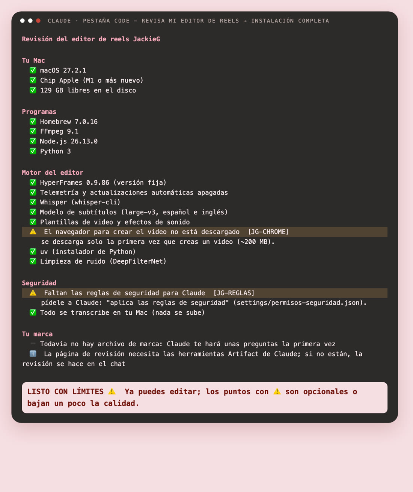
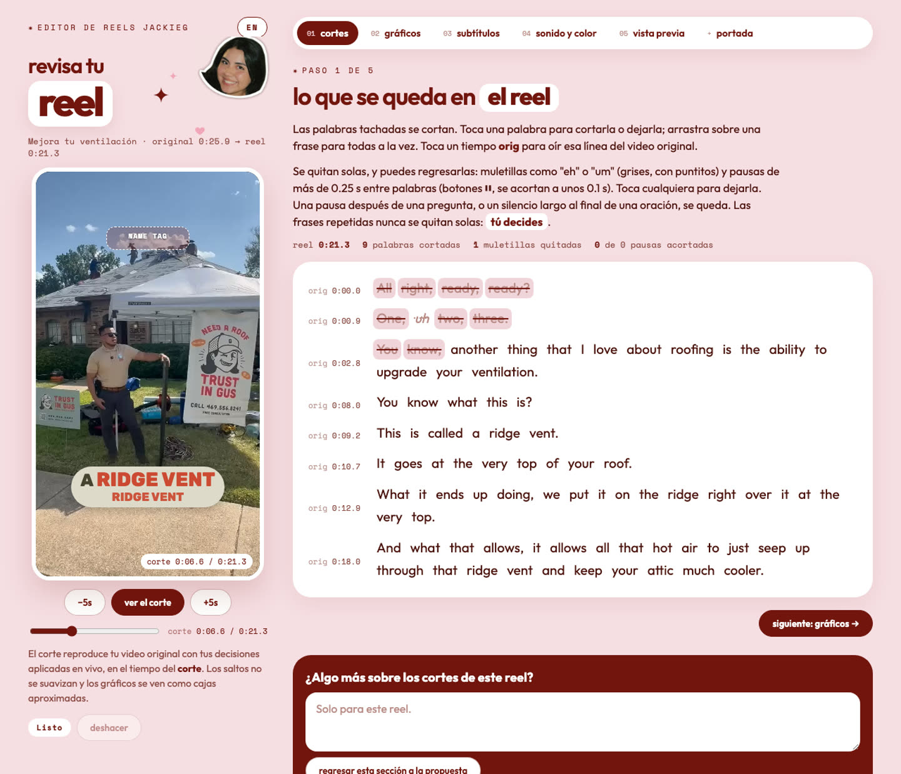
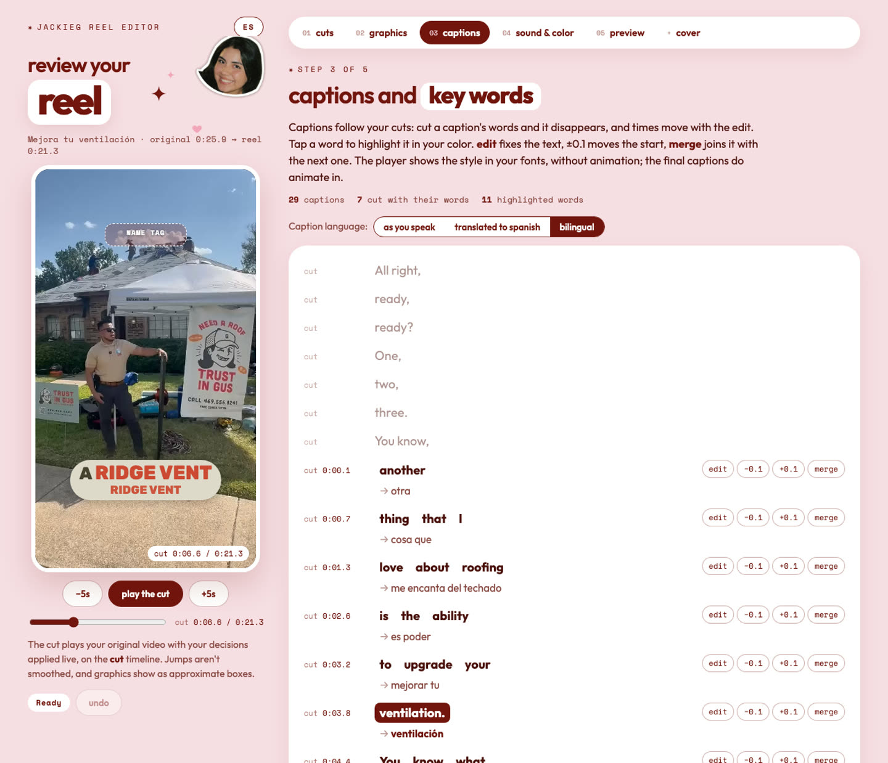

# ✷ JackieG Reel Editor

**deja que claude edite tus reels** · *let claude edit your reels*

[Español](#español) · [English](#english)

---

## Español

Grabas un video hablando a la cámara con tu celular. Claude lo edita en tu Mac. Tú apruebas cada corte. Sale tu reel vertical (1080×1920) listo para Instagram o TikTok: sin pausas ni muletillas, con el ruido de fondo limpio, subtítulos con tu marca y tus gráficos.

- ✷ **Subtítulos en español, en inglés o en Spanglish.** El idioma se detecta solo. También traducidos o bilingües: Claude escribe la traducción y tú la revisas.
- ✷ **Varios videos en un reel.** Arrastra varios y Claude los junta en orden.
- ✷ **Tú decides.** Una página de revisión privada donde tocas palabras para cortarlas, revisas gráficos y subtítulos, y apruebas antes del video final.
- ✷ **Todo en tu Mac.** Tus videos originales nunca se cambian. Nada de pagos extra ni suscripciones nuevas: solo tu plan de Claude.

### ✷ Lo que necesitas
- Una Mac con chip Apple (M1 o más nuevo) y macOS 13 o más nuevo
- Unos 15 GB libres
- La app de Claude para escritorio con un plan de pago (cada quien su cuenta)
- Una hora sin prisa la primera vez

### ✷ Instalar, un paso a la vez
1. **Homebrew (lo haces tú, una vez).** [**Descarga Homebrew.pkg**](https://github.com/Homebrew/brew/releases/latest/download/Homebrew.pkg) (el instalador oficial, unos 150 MB), ábrelo con doble clic y sigue los pasos. No uses el comando de la página brew.sh: es para la Terminal. Tu Mac te pide su contraseña en su propia ventana: escríbela solo ahí, nunca en el chat.
2. **Baja el editor:** [**descargar jackieg-reel-editor.zip**](https://github.com/roofsbygus/jackieg-reel-editor/releases/latest/download/jackieg-reel-editor.zip). Ábrelo (doble clic) y mueve la carpeta `jackieg-reel-editor` a tu carpeta **Documentos**.
3. **Ábrelo en Claude.** En la app de Claude, pestaña **Code**, selecciona la carpeta `Documentos/jackieg-reel-editor`.
4. **Escribe:** `instala mi editor de reels`. Claude hace 7 pasos fijos (la primera vez tarda de 20 a 40 minutos, baja unos 4 GB). Cuando pida permiso, lee y aprueba.
5. **Revisión final.** Termina en **LISTO ✅** o **LISTO CON LÍMITES ⚠️** (las dos quieren decir que ya puedes editar). Para correrla otra vez: `revisa mi editor de reels`.

No usas la Terminal en ningún momento: Claude corre todo dentro de la pestaña Code y te pide permiso.

### ✷ Tu primer reel
En cualquier chat de la pestaña Code: escribe **`/jackieg-reel-editor`** o arrastra tu video y di **`edita mi reel`**. La primera vez te hace unas preguntas de tu marca (5 minutos). Tu reel queda en **Películas → Reels**.

| | |
|---|---|
| **empezar** | arrastra tu video + "edita mi reel" |
| **varios videos** | arrástralos todos + "junta estos videos y edita mi reel" |
| **revisar** | "ver el corte" y toca palabras para cortar o recuperar |
| **vista previa** | "crear vista previa" en la página y "crea la vista previa" en el chat |
| **problemas** | dile a Claude "arregla esto" |

---

## English

Record yourself talking to the camera on your phone. Claude edits it on your Mac. You approve every cut. Out comes your vertical reel (1080×1920), ready for Instagram or TikTok: no pauses or filler words, background noise cleaned up, captions and graphics in your brand.

- ✷ **Captions in English, Spanish or Spanglish**, detected automatically. Also translated or bilingual: Claude writes the translation, you check it.
- ✷ **Several clips in one reel.** Drop in a few and Claude joins them in order.
- ✷ **You decide.** A private review page where you tap words to cut them, check graphics and captions, and approve before the final video.
- ✷ **Everything on your Mac.** Your original videos are never changed. No extra payments or new subscriptions: just your Claude plan.

### ✷ What you need
- A Mac with an Apple chip (M1 or newer) and macOS 13 or newer
- About 15 GB free
- The Claude desktop app on a paid plan (your own account)
- An unhurried hour the first time

### ✷ Install, one step at a time
1. **Homebrew (you do this, once).** [**Download Homebrew.pkg**](https://github.com/Homebrew/brew/releases/latest/download/Homebrew.pkg) (the official installer, about 150 MB), double-click it and follow the steps. Skip the command on the brew.sh page: that one is for Terminal. Your Mac asks for its password in its own window: type it only there, never in the chat.
2. **Get the editor:** [**download jackieg-reel-editor.zip**](https://github.com/roofsbygus/jackieg-reel-editor/releases/latest/download/jackieg-reel-editor.zip). Open it (double-click) and move the `jackieg-reel-editor` folder into your **Documents** folder.
3. **Open it in Claude.** In the Claude app, **Code** tab, select the `Documents/jackieg-reel-editor` folder.
4. **Type:** `install my reel editor`. Claude runs 7 fixed steps (the first time takes 20 to 40 minutes and downloads about 4 GB). When it asks permission, read and approve.
5. **Final check.** It ends with **READY ✅** or **READY WITH LIMITS ⚠️** (both mean you can edit). To run it again: `check my reel editor`.

You never use Terminal: Claude runs everything inside the Code tab and asks your permission.

### ✷ Your first reel
In any Code-tab chat: type **`/jackieg-reel-editor`**, or drop in your video and say **`edit my reel`**. The first time it asks a few questions about your brand (5 minutes). Your reel is saved in **Movies → Reels**.

---

## ✷ Credits

Based on [claude-reel-editor](https://github.com/nicolapocock/claude-reel-editor) by **Nicola Pocock** ([@getgitgirl](https://instagram.com/getgitgirl)), MIT license. Thank you, Nicola. The original README is in [docs/upstream-README.md](docs/upstream-README.md).

Uses [HyperFrames](https://github.com/heygen-com/hyperframes) (Apache-2.0, by HeyGen) to transcribe and build the video; not affiliated with HeyGen. Details in [THIRD_PARTY_NOTICES.md](THIRD_PARTY_NOTICES.md).

Built by [Perlili Development Studio](https://perlili.dev) for **Jackie G** ([@jackiegsancen](https://instagram.com/jackiegsancen)), Latinos en Roofing University and Latinos in Business. Licensed under [MIT](LICENSE).

@jackiegsancen

